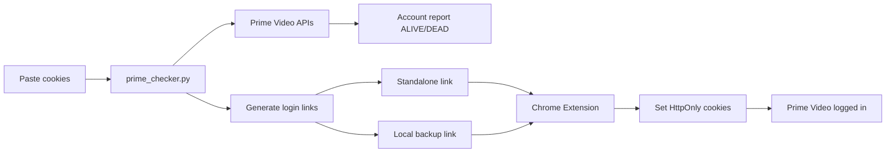

# Prime Video Cookie to Session Tool

**Author:** [Deepesh](https://github.com/deepesh8216) (`@deepesh8216`)

A self-hosted local toolkit to **validate Prime Video cookies**, **extract account information**, and **generate login links** that open an authenticated Prime Video session in the browser using a companion Chrome extension.

> **Disclaimer:** This project is for **personal and educational use only**. Use only on Amazon accounts you own or are explicitly authorized to test. Importing or sharing session cookies may violate [Amazon's Terms of Service](https://www.amazon.com/gp/help/customer/display.html). The author is not responsible for misuse.

---

## Features

| Feature | Description |
|---------|-------------|
| Cookie validation | Checks if Prime Video session cookies are alive or expired |
| Account report | Profile name, region, plan tier, customer ID |
| Standalone login links | `https://www.primevideo.com/#pvimport=...` — no server needed after generation |
| Local backup links | `http://127.0.0.1:5050/login/...` — fallback when standalone fails |
| Chrome extension | Imports HttpOnly cookies and supports incognito |
| Web UI | Dark dashboard at `http://127.0.0.1:5050` |
| CLI mode | Validate cookies and print results from terminal |
| Playwright launch | Open logged-in Prime Video without extension (optional) |
| Multi-format cookies | Netscape `.txt`, JSON, raw cookie strings |

---

## How It Works



### Why an extension is required

Prime Video auth cookies (`session-token`, `at-main-av`, etc.) are **HttpOnly**. A normal website URL cannot set them — only a browser extension (or automation like Playwright) can. Amazon does **not** provide a Netflix-style `?nftoken=` server login URL for Prime Video.

---

## Project Structure

```
prime-video-cookie-to-session-hijacking/
├── prime_checker.py          # Main server, CLI, cookie validation logic
├── pvimport_codec.py         # Gzip + base64 payload encoding for login links
├── requirements.txt          # No required deps (Python stdlib only)
├── requirements-optional.txt # Playwright (optional browser launch)
├── static/
│   ├── index.html            # Web UI dashboard
│   └── login.html            # Local login redirect page
└── extension/
    ├── manifest.json         # Chrome extension manifest (v1.4.0)
    ├── background.js         # Cookie import + link interception
    ├── content.js            # Localhost login page handler
    ├── import.html           # Extension import page
    └── import.js             # Decode payload + import cookies
```

---

## Requirements

- **Python 3.10+** (stdlib only for core features)
- **Google Chrome** or **Chromium-based browser**
- **Chrome extension** (included in `extension/` folder)
- **Playwright** (optional) — for `--open` CLI mode without extension

---

## Installation

### 1. Clone the repository

```bash
git clone https://github.com/deepesh8216/prime-video-cookie-to-session-hijacking.git
cd prime-video-cookie-to-session-hijacking
```

### 2. Install the Chrome extension

1. Open `chrome://extensions`
2. Enable **Developer mode**
3. Click **Load unpacked**
4. Select the `extension/` folder
5. Click **Details** → enable **Allow in incognito**
6. Confirm version **1.4.0**

### 3. (Optional) Install Playwright

```bash
pip install -r requirements-optional.txt
playwright install chromium
```

---

## Usage

### Web UI (recommended)

```bash
python3 prime_checker.py
```

Open **http://127.0.0.1:5050**

1. Paste Prime Video cookies (Netscape or JSON format)
2. Click **Initiate Verification**
3. Copy a login link:
   - **Standalone** — works without keeping the terminal open
   - **Local backup** — requires `prime_checker.py` to stay running

### CLI mode

```bash
# Validate cookies from file
python3 prime_checker.py --cli cookies.txt

# Validate from stdin
cat cookies.txt | python3 prime_checker.py --cli

# Open browser with Playwright (no extension needed)
python3 prime_checker.py --cli cookies.txt --open
```

---

## Login Link Types

### Standalone link (primary)

```
https://www.primevideo.com/#pvimport=<gzip-compressed-base64-payload>
```

- Session data is embedded in the URL
- Extension intercepts the link before Prime Video redirects
- Redirects to extension `import.html` → sets cookies → opens Prime Video
- Works in **incognito** (extension must allow incognito)
- **No terminal needed** after link is generated

### Local backup link

```
http://127.0.0.1:5050/login/<token>?target=pc
```

- Session stored in local server memory (1 hour TTL)
- Requires `python3 prime_checker.py` to be running
- More reliable fallback if standalone link fails

### Target variants

| Target | Redirect URL |
|--------|--------------|
| `pc` | `https://www.primevideo.com/` (or regional) |
| `mobile` | `https://www.primevideo.com/storefront` |
| `tv` | `https://www.primevideo.com/livetv` |

---

## Supported Cookie Formats

### Netscape format

```text
.primevideo.com	TRUE	/	TRUE	2082758400	session-token	YOUR_VALUE
.primevideo.com	TRUE	/	TRUE	2082758400	ubid-main-av	YOUR_VALUE
.primevideo.com	TRUE	/	TRUE	2082758400	at-main-av	YOUR_VALUE
```

### JSON format (Cookie-Editor export)

```json
[
  {
    "domain": ".primevideo.com",
    "path": "/",
    "secure": true,
    "expirationDate": 2082758400,
    "name": "session-token",
    "value": "YOUR_VALUE"
  }
]
```

### Required auth cookies (at least one)

`session-token`, `x-main-av`, `at-main-av`, `ubid-main-av`, `sess-at-main-av`, `session-id`

---

## API Endpoints

| Method | Path | Description |
|--------|------|-------------|
| `GET` | `/` | Web UI dashboard |
| `POST` | `/api/check` | Validate cookies, return account info + login links |
| `GET` | `/login/<token>?target=pc` | Local login page (backup flow) |
| `GET` | `/api/session/<token>` | Fetch session cookies for local login |
| `POST` | `/api/launch` | Launch Playwright browser with cookies |

### POST `/api/check` example

**Request:**
```json
{
  "cookies": ".primevideo.com\tTRUE\t/\tTRUE\t2082758400\tsession-token\t..."
}
```

**Response (alive):**
```json
{
  "status": "ALIVE",
  "alive": true,
  "account": {
    "profile": "YourProfile",
    "region": "IN",
    "plan": "Prime (Paid)",
    "customer_id": "A1B2C3..."
  },
  "standalone_links": {
    "pc": "https://www.primevideo.com/#pvimport=...",
    "mobile": "https://www.primevideo.com/storefront#pvimport=...",
    "tv": "https://www.primevideo.com/livetv#pvimport=..."
  },
  "local_links": {
    "pc": "http://127.0.0.1:5050/login/TOKEN?target=pc",
    "mobile": "http://127.0.0.1:5050/login/TOKEN?target=mobile",
    "tv": "http://127.0.0.1:5050/login/TOKEN?target=tv"
  }
}
```

---

## Python Modules & Methods

### `prime_checker.py`

| Function | Purpose |
|----------|---------|
| `parse_cookie_text()` | Parse Netscape, JSON, or raw cookie strings |
| `check_cookies()` | Full validation pipeline — returns status + links |
| `analyze_storefront()` | Fetch Prime Video storefront with cookies |
| `get_configuration()` | Call Amazon `GetConfiguration` API |
| `infer_account()` | Extract profile, region, plan, customer ID |
| `generate_login_links()` | Create standalone + local backup links |
| `store_session()` / `get_session()` | In-memory session store for local links |
| `launch_prime_browser()` | Playwright one-click browser open |
| `netscape_to_editor_json()` | Convert cookies to Cookie-Editor JSON |
| `links_for_region()` | Build region-aware Prime Video URLs |

### `pvimport_codec.py`

| Function | Purpose |
|----------|---------|
| `filter_essential_cookies()` | Keep only auth-related cookies |
| `encode_pvimport_payload()` | Gzip + URL-safe base64 encode for links |

---

## Chrome Extension (v1.4.0)

| File | Role |
|------|------|
| `background.js` | Intercepts `#pvimport=` links, sets cookies via `chrome.cookies` API, resolves incognito cookie store |
| `import.html` / `import.js` | Extension import page — decode payload, import, redirect |
| `content.js` | Handles local `127.0.0.1:5050/login/` backup flow |

### Extension flow (standalone link)

1. User pastes `https://www.primevideo.com/#pvimport=...`
2. `webNavigation.onBeforeNavigate` intercepts before Prime redirect
3. Tab redirected to `chrome-extension://.../import.html`
4. Cookies imported into correct store (normal or incognito)
5. User redirected to Prime Video — logged in

---

## Platform Support

| Platform | Standalone link | Local link | Extension required |
|----------|----------------|------------|-------------------|
| PC Chrome | ✅ | ✅ | Yes |
| PC incognito | ✅ | ✅ | Yes (+ allow incognito) |
| Android (Kiwi Browser) | ✅ | ❌ | Yes (load same extension) |
| iPhone Safari | ❌ | ❌ | No extension support |
| Smart TV | ❌ | ❌ | No extension support |
| Prime Video **app** | ❌ | ❌ | App uses separate auth |

---

## Validation Logic

A session is **ALIVE** when:

1. Storefront loads without redirect to sign-in
2. `GetConfiguration` API returns HTTP 200
3. `customerID` is present and non-empty
4. Watchlist action indicates authenticated state

A session is **DEAD** when:

- Redirected to Amazon sign-in (HTTP 401)
- Empty `customerID` (HTTP 412)
- Amazon blocks request (HTTP 403)
- Cookies expired or invalid

---

## Security Notes

- All processing runs **locally** on your machine
- Cookies are **never sent to third-party servers** (only to Amazon for validation)
- Login link payloads contain **full session data** — treat links as passwords
- Links expire when cookies expire or local session TTL (1 hour) passes
- Never commit real cookie files to git

---

## Troubleshooting

| Problem | Solution |
|---------|----------|
| Fresh Prime login page | Reload extension v1.4.0, enable incognito, regenerate link |
| "Extension not connected" | `chrome://extensions` → Reload → Allow in incognito |
| "Session expired" on local link | Restart server and generate new link |
| Standalone link fails | Use **Local backup** link with server running |
| Works in normal window, not incognito | Enable **Allow in incognito** on extension |

---

## Limitations

- No Netflix-style server token — Amazon does not expose this for Prime Video
- Native Prime Video **mobile app** cannot use web cookies
- Smart TV browsers cannot run Chrome extensions
- HttpOnly cookies require extension or Playwright — plain URLs alone cannot log in

---

## License

This project is provided as-is for educational purposes. Use responsibly.

---

## Author

**Deepesh** — [@deepesh8216](https://github.com/deepesh8216)

Repository: [prime-video-cookie-to-session-hijacking](https://github.com/deepesh8216/prime-video-cookie-to-session-hijacking)
